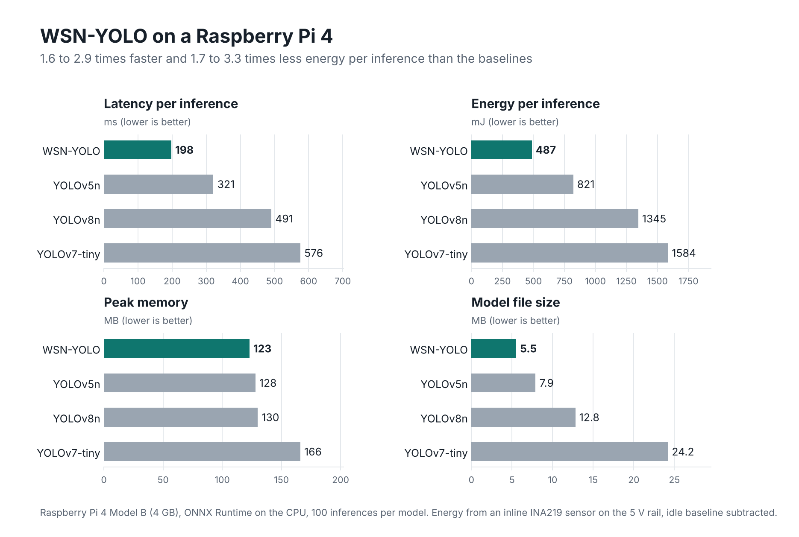

# WSN-YOLO: Ultra-Lightweight Object Detection for Wireless Sensor Networks via Sperm Swarm Optimization

[](https://www.python.org/downloads/)
[](https://pytorch.org/)
[](https://opensource.org/licenses/MIT)

An ultra-lightweight YOLO architecture optimized for deployment in resource-constrained Wireless Sensor Networks (WSN) using Sperm Swarm Optimization (SSO) for neural architecture search. Based on [YOLOv7](https://github.com/WongKinYiu/yolov7).

## Approach

The architecture is not a shrunk copy of an existing model. Sperm Swarm Optimization (SSO) searches the network structure directly, scoring each candidate on accuracy together with FLOPs, parameter count and inference time, so the result suits wireless sensor nodes with very little memory and power. It is compared against YOLOv7-tiny, YOLOv5n and YOLOv8n baselines under the same data and training conditions. Headline results are below; the full pipeline and all logged metrics are in [`rebuild-v2/`](rebuild-v2/).

## Key Results (WSN-FaultBench loc_hard, detection)

Fault **localisation** (multi-class bounding-box detection), as reported in the paper:

| Detector | mAP@0.5 | mAP@0.5:0.95 | Params (M) | GFLOPs |
|---|---:|---:|---:|---:|
| **WSN-YOLO** | 0.913 | 0.832 | **1.35** | **2.6** |
| YOLOv5n | 0.925 | 0.857 | 1.76 | 4.2 |
| YOLOv8n | 0.945 | 0.896 | 3.01 | 8.1 |
| YOLOv7-tiny | 0.930 | 0.865 | 6.02 | 13.2 |

WSN-YOLO sits at the efficiency knee: within one to three points of far larger
detectors at 4.5x fewer parameters than YOLOv7-tiny.

## On-Device Deployment (Raspberry Pi 4)

All four detectors were deployed on a Raspberry Pi 4 (ONNX Runtime, CPU) and
measured directly, with per-inference energy taken from an inline INA219 current
sensor (idle baseline subtracted). WSN-YOLO is the fastest, smallest, and
lowest-energy detector on real hardware. Code and full notes: [`deployment/`](deployment/).

| Detector | ONNX size (MB) | Latency mean (ms) | Peak RAM (MB) | Power (W) | Energy (mJ) |
|---|---:|---:|---:|---:|---:|
| **WSN-YOLO** | **5.5** | **197.6** | **123** | **4.77** | **486.9** |
| YOLOv5n | 7.9 | 321.0 | 128 | 4.89 | 821.2 |
| YOLOv8n | 12.8 | 490.9 | 130 | 5.10 | 1344.7 |
| YOLOv7-tiny | 24.2 | 575.8 | 166 | 5.15 | 1584.2 |

WSN-YOLO runs 1.6–2.9x faster and draws 1.7–3.3x less energy per inference than the baselines.

<picture>
  <source media="(prefers-color-scheme: dark)" srcset="deployment/pi_results_dark.png">
  
</picture>

A one page summary is in [`deployment/pi_results_onepager.pdf`](deployment/pi_results_onepager.pdf).

## Project Structure

```
yolov7/
├── cfg/                        # Model configurations
│   ├── training/
│   │   ├── yolo_wsn_sso_optimized.yaml  # SSO-optimized WSN model
│   │   └── yolov7-tiny.yaml             # Baseline model
│   └── deploy/
├── data/                       # Dataset configs & hyperparameters
│   ├── hyp.wsn.yaml           # WSN-optimized hyperparameters
│   ├── hyp.scratch.tiny.yaml  # Baseline hyperparameters
│   └── wsn_dataset.yaml       # Dataset configuration
├── models/                     # Model implementations
├── utils/                      # Utility functions
├── SSO/                        # SSO optimization code
│   ├── sso_architecture_optimizer.py
│   ├── sso_hyperparameter_optimizer.py
│   └── SSO.m                   # Original MATLAB implementation
├── deployment/                 # Raspberry Pi 4 + INA219 on-device energy testing
│   ├── measure_pi.py           # latency / RAM / power / energy per inference
│   ├── setup.sh, measure_energy.sh
│   └── README.md               # wiring, protocol, measured results
├── runs/                       # Training outputs
│   └── (current runs in rebuild-v2/results/)
├── train.py                    # Training script
├── test.py                     # Validation script
├── detect.py                   # Inference script
└── export.py                   # Model export script
```

## Installation

```bash
# Clone the repository
git clone https://github.com/mh-masum6875/LightYolo-SSO
cd LightYolo-SSO

# Install dependencies
pip install -r requirements.txt
```

## Dataset

The WSN-FaultBench benchmark is built from the Intel Berkeley Research Laboratory (IBRL) streams (loc_hard tier, fault localisation):
- **Images**: 256×256 greyscale windows with bounding-box fault labels
- **Classes**: 4 fault types (spike, stuck, drift, noise)
- **Split (loc_hard)**: Train (11,745) / Val (1,467) / Test (1,470)

## Training

### Train WSN-YOLO (SSO-optimized)

```bash
python train.py \
    --weights yolov7-tiny.pt \
    --cfg cfg/training/yolo_wsn_sso_optimized.yaml \
    --data data/wsn_dataset.yaml \
    --hyp data/hyp.wsn.yaml \
    --epochs 150 \
    --batch-size 32 \
    --img-size 640 \
    --name wsn_yolo
```

### Train YOLOv7-tiny baseline

```bash
python train.py \
    --weights yolov7-tiny.pt \
    --cfg cfg/training/yolov7-tiny.yaml \
    --data data/wsn_dataset.yaml \
    --hyp data/hyp.scratch.tiny.yaml \
    --epochs 150 \
    --batch-size 16 \
    --img-size 640 \
    --name yolov7_tiny_baseline
```

## SSO Optimization

### Architecture Search

```bash
cd SSO
python sso_architecture_optimizer.py --population 20 --iterations 30
```

### Hyperparameter Optimization

```bash
python sso_hyperparameter_optimizer.py --population 15 --iterations 20
```

## Inference

```bash
python detect.py \
    --weights rebuild-v2/trained_models/loc_hard_yolov8n.pt \
    --source path/to/images \
    --img-size 640 \
    --conf-thres 0.25
```

## Validation

```bash
python test.py \
    --data data/wsn_dataset.yaml \
    --weights rebuild-v2/trained_models/loc_hard_yolov8n.pt \
    --task val
```

## Pre-trained Weights

Download YOLOv7-tiny pre-trained weights:
```bash
wget https://github.com/WongKinYiu/yolov7/releases/download/v0.1/yolov7-tiny.pt
```

## SSO Algorithm

The Sperm Swarm Optimization algorithm uses biologically-inspired movement patterns:

**Velocity Update:**
```
v(t+1) = r₁·ln(ρ₁)·v(t) + ln(ρ₂)·ln(ρ₃)·(pbest - x(t)) + ln(ρ₂)·ln(ρ₃)·(gbest - x(t))
```

**Multi-Objective Fitness:**
```
J(θ) = w₁·(1 - mAP) + w₂·FLOPs/F_tar + w₃·Params/P_tar + w₄·T_inf
```

With weights [0.4, 0.3, 0.2, 0.1] balancing accuracy and efficiency.

## Training Results

The current results are in `rebuild-v2/results/`:
- `results.sqlite` - all logged metrics (36k-row runs table)
- `trained_models/` - available trained weights and the YOLOv8n ONNX
- `results/wp3_yolov8/` - YOLOv8n loc_hard curves (PR, confusion, results)

## Citation

```bibtex
@article{wsn_yolo_sso,
  title={Ultra-Lightweight YOLO Architecture for Wireless Sensor Networks via Sperm Swarm Optimization},
  author={Maidul Hasan Masum},
  year={2025}
}
```

## References

1. Shehadeh, H.A., et al. "Sperm swarm optimization algorithm for optimizing wireless sensor network challenges." IEEE Access 9 (2021).
2. Wang, C.Y., et al. "YOLOv7: Trainable bag-of-freebies sets new state-of-the-art for real-time object detectors." CVPR 2023.

## License

This project is licensed under the MIT License.

## Acknowledgments

- YOLOv7 implementation based on [WongKinYiu/yolov7](https://github.com/WongKinYiu/yolov7)
- SSO algorithm based on Shehadeh et al.'s original implementation

